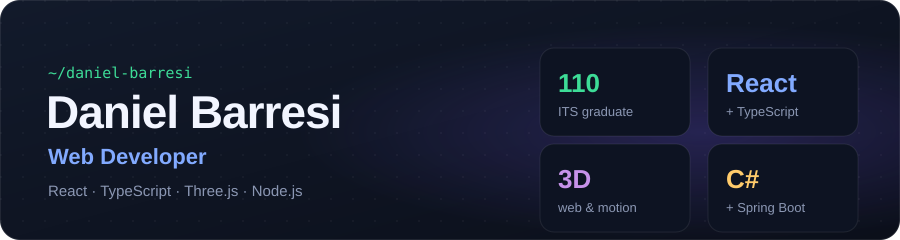
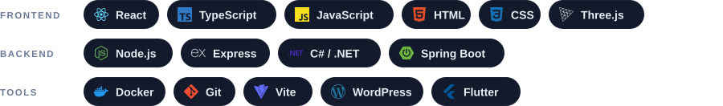
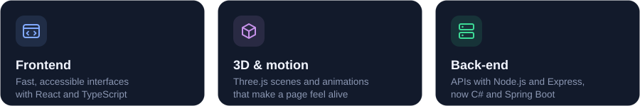

  

### About me

- 💻 Web developer focused on **React** and **TypeScript**, with a passion for 3D and motion on the web
- 🎓 Graduated in **Web & Mobile Development** at ITS Steve Jobs Academy, final grade **110**
- 🌱 Currently learning back-end development with **C#**, **Spring Boot** and **Docker**
- 🎯 Goal: building world-class 3D, animated websites

### Tech stack

### What I do

### Get in touch

&nbsp;

